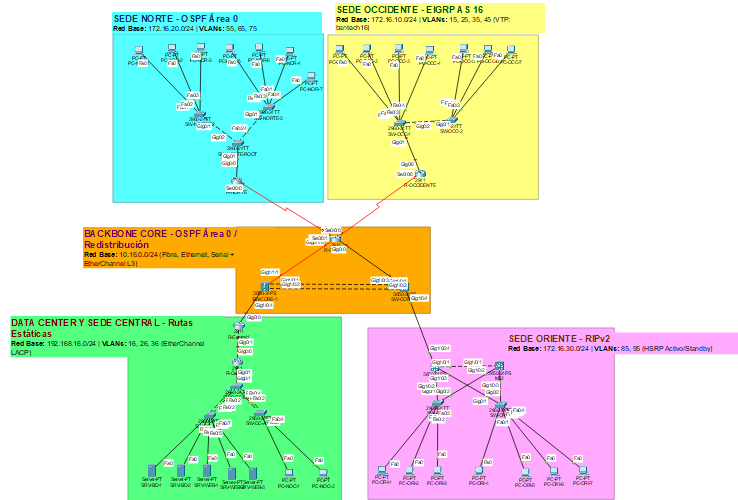

# Proyecto 2: Infraestructura Financiera y Alta Disponibilidad - BanTech GT
**Universidad de San Carlos de Guatemala (USAC) - Facultad de Ingeniería**  
**Escuela de Ciencias y Sistemas - Redes de Computadoras 1 (Segundo Semestre 2026)**  
**Grupo No. 5**

## Integrantes del Grupo
| Nombre Completo | Carnet | Rol en el Proyecto |
| :--- | :---: | :--- |
| **Francisco Javier Cetino Mendez** *(Coordinador)* | `202006716` | Diseño de Arquitectura, Topología en Packet Tracer, Cálculo VLSM y Documentación |
| *[Nombre Integrante 2]* | *[Carnet 2]* | Implementación de Switching, VLANs, VTP, Rapid PVST+, EtherChannel L2 y HSRP |
| *[Nombre Integrante 3]* | *[Carnet 3]* | Implementación de Backbone Core, Enrutamiento (OSPF, EIGRP, RIPv2, Estático) y Redistribución |

---

## 1. Reglas de Identificación y Parámetros del Diseño
De acuerdo con los lineamientos del proyecto, los parámetros de direccionamiento IP, dominios administrativos e identificadores de VLAN se rigen por los datos del coordinador y número de grupo:
* **Coordinador del Grupo:** Francisco Cetino — **Carnet:** `202006716`
* **Parámetro $XX$ (Últimos dos dígitos del carnet del coordinador):** `16`
* **Número de Grupo:** `5`
* **Parámetro $Y$ (Último dígito del número de grupo):** `5`
* **Dominio VTP (Sede Occidente):** `bantech16` (Password: `cisco`)

---

## 2. Arquitectura del Backbone Core y Dominios de Enrutamiento

### 2.1 Diseño del Núcleo Nacional (Backbone Core)
El Backbone Core de **BanTech GT** se diseñó mediante una topología en anillo redundante de Capa 3 compuesta por tres dispositivos centrales (`SW-CORE-1`, `SW-CORE-2` y `R-CORE-3`):
1. **Agregación de Enlaces en el Núcleo:** `SW-CORE-1` y `SW-CORE-2` están interconectados mediante un **EtherChannel de Capa 3 (`Port-channel 1` con protocolo LACP)** utilizando dos enlaces GigabitEthernet paralelos (`Gi1/0/1` y `Gi1/0/2`), proporcionando mayor ancho de banda y tolerancia a fallos en el canal principal de transporte transaccional.
2. **Diversidad de Medios Físicos:**
   * **Fibra Óptica:** Implementada entre `SW-CORE-1` (`Gi1/1/1`) y `R-CORE-3` (`Gi0/1/0`) mediante transceptores SFP `GLC-LH-SMD` para soportar tráfico crítico de alta velocidad e inmunidad electromagnética en el núcleo.
   * **Ethernet (Cobre):** Implementado entre `SW-CORE-2` (`Gi1/0/3`) y `R-CORE-3` (`Gi0/0`), así como hacia los nodos de frontera locales (`R-Central1` y `MS1`).
   * **Enlaces Seriales WAN:** Implementados desde `R-CORE-3` (`Se0/0/0` y `Se0/0/1`) hacia las sedes regionales remotas (`R-Occidente` y `R-Norte`).

### 2.2 Asignación y Justificación de Protocolos de Enrutamiento por Sede
* **Núcleo y Sede Norte — OSPF (`Proceso 1, Área 0`):** Se eligió OSPF (protocolo de estado de enlace) para el Backbone principal y el Centro de Autorización de Créditos (Sede Norte) debido a su rápida convergencia mediante el algoritmo Dijkstra (SPF) y su jerarquía de áreas, garantizando que las aprobaciones de crédito a nivel nacional nunca sufran retrasos por recálculo de rutas.
* **Sede Occidente — EIGRP (`AS 16`):** Se asignó EIGRP a la Agencia Regional Comercial de Occidente por ser un dominio de expansión regional con alto volumen de transacciones físicas. El algoritmo DUAL de EIGRP ofrece rutas de respaldo instantáneas (*Feasible Successors*) y un uso eficiente del ancho de banda sobre enlaces seriales WAN.
* **Sede Oriente — RIPv2:** Dado que la Sede Oriente corresponde a un Centro Financiero Legado recién adquirido por BanTech GT, se implementó RIPv2 (`version 2`, `no auto-summary`) para garantizar compatibilidad con los equipos heredados mientras se integra al núcleo corporativo.
* **Data Center y Sede Central — Rutas Estáticas:** Por políticas estrictas de seguridad de la información, el segmento entre `R-Central1` y `R-Central2` opera exclusivamente con enrutamiento estático, evitando que paquetes de protocolos dinámicos expongan la topología interna de las granjas de servidores (`Core_BD`, `Web_Apps` y `NOC`).

### 2.3 Puntos de Redistribución de Rutas
Se establecieron **tres puntos estratégicos de redistribución** en el Backbone Core para garantizar convergencia total extremo a extremo:
1. **`R-CORE-3`:** Punto de redistribución mutua entre **OSPF (Área 0)** y **EIGRP (AS 16)** (conecta el núcleo y Sede Norte con Sede Occidente).
2. **`SW-CORE-2`:** Punto de redistribución mutua entre **OSPF (Área 0)** y **RIPv2** (integra la Sede Oriente legada al núcleo nacional).
3. **`R-Central1`:** Punto de redistribución que recibe las **rutas estáticas** desde `R-Central2` (Data Center) y las propaga hacia el dominio **OSPF** del Backbone Core mediante `redistribute static subnets`.

---

## 3. Justificación Técnica de Arquitectura y Mapeo Lógico por Sede

### 3.1 Sede Occidente (Agencia Regional Comercial)
* **Justificación de la Topología y Tolerancia a Fallos:** Se diseñó una topología jerárquica en estrella extendida conectada a `R-Occidente` mediante dos switches de acceso (`SW-OCC-1` y `SW-OCC-2`). Esta arquitectura es altamente eficiente para una agencia comercial porque segmenta el tráfico en 4 dominios de broadcast (VLANs) y centraliza la administración mediante **VTP (`bantech16`)**, asegurando que cualquier cambio de VLAN en `SW-OCC-1` se replique automáticamente en `SW-OCC-2` sin errores manuales.
* **Respuesta a la Necesidad Operativa:** Al implementar **Router-on-a-Stick** en `R-Occidente`, un fallo o congestión en la red de *Asesores* (`VLAN 25`) queda aislado en su propia subinterfaz y no afecta las transacciones críticas del área de *Cajas* (`VLAN 15`) ni el monitoreo de *Seguridad* (`VLAN 45`).
* **Mapeo Lógico:**
  * **Router de Borde (Inter-VLAN):** `R-Occidente` (`Gi0/0.15`, `Gi0/0.25`, `Gi0/0.35`, `Gi0/0.45`).
  * **Switch Principal (VTP Server):** `SW-OCC-1` | **Switch Secundario (VTP Client):** `SW-OCC-2`.
  * **Enlaces Troncales (`802.1Q`):** `R-Occidente (Gi0/0) <-> SW-OCC-1 (Gi0/1)` y `SW-OCC-1 (Gi0/2) <-> SW-OCC-2 (Gi0/1)`.
  * **Puertos de Acceso:** `SW-OCC-1` (`Fa0/1-2` -> VLAN 15, `Fa0/3-4` -> VLAN 25) y `SW-OCC-2` (`Fa0/1` -> VLAN 35, `Fa0/2-3` -> VLAN 45).

### 3.2 Sede Norte (Centro de Autorización de Créditos)
* **Justificación de la Topología, Tolerancia a Fallos y Elección del Root Bridge:** Se implementó una topología en **anillo/triángulo físico cerrado** entre tres switches (`SW-NORTE-ROOT`, `SW-NORTE-2` y `SW-NORTE-3`) ejecutando **Rapid PVST+ (`spanning-tree mode rapid-pvst`)**. Se forzó explícitamente a `SW-NORTE-ROOT` como **Root Bridge** (`priority 4096`) debido a que es el switch de agregación directamente conectado al router de frontera `R-Norte`; esto garantiza que el árbol de expansión mantenga activos los enlaces directos de subida desde los switches de acceso y bloquee únicamente el enlace redundante horizontal, optimizando la latencia hacia el gateway.
* **Respuesta a la Necesidad Operativa:** Elimina cualquier punto único de falla físico en Capa 2 para los analistas de riesgo. Si un cable troncal falla, Rapid PVST+ converge inmediatamente habilitando el camino alterno del triángulo sin interrumpir la autorización nacional de créditos.
* **Mapeo Lógico:**
  * **Router de Borde (Inter-VLAN):** `R-Norte` (`Gi0/0.55`, `Gi0/0.65`, `Gi0/0.75`).
  * **Switch Principal (Root Bridge Forzado):** `SW-NORTE-ROOT` | **Switches de Acceso:** `SW-NORTE-2` y `SW-NORTE-3`.
  * **Enlaces Troncales (`802.1Q`):** `R-Norte (Gi0/0) <-> SW-NORTE-ROOT (Gi0/1)` y los 3 enlaces del anillo (`Gi0/2`, `Fa0/24`, `Gi0/1-2`).
  * **Puertos de Acceso:** `SW-NORTE-2` (`Fa0/1-3` -> VLAN 55) y `SW-NORTE-3` (`Fa0/1-2` -> VLAN 65, `Fa0/3-4` -> VLAN 75).

### 3.3 Sede Oriente (Centro Financiero Legado)
* **Justificación de la Topología y Tolerancia a Fallos:** Se diseñó una topología de distribución redundante con dos switches multicapa en cascada (`MS1` y `MS2`) y dos switches de acceso (`SW-ORI-1` y `SW-ORI-2`) conectados simultáneamente a ambos switches multicapa. Se configuró **HSRP (Hot Standby Router Protocol)** en las interfaces SVI de las VLANs `85` y `95`, asignando a `MS1` el rol de *Active Router* (prioridad `110` con `preempt`) y a `MS2` el rol de *Standby Router* (prioridad `100`).
* **Respuesta a la Necesidad Operativa:** Asegura alta disponibilidad de primer salto (Gateway) para *Bóveda* y *Plataforma VIP*. Si `MS1` sufre un corte de energía o caída de interfaz, `MS2` asume de forma transparente la IP virtual de gateway sin que las PCs pierdan conectividad hacia el núcleo del banco.
* **Mapeo Lógico:**
  * **Switches Principales/Distribución (Gateways HSRP e Inter-VLAN SVI):** `MS1` (Activo) y `MS2` (Standby).
  * **Switches de Acceso:** `SW-ORI-1` y `SW-ORI-2`.
  * **Enlaces Troncales (`802.1Q`):** Cascada `MS1 (Gi1/0/1) <-> MS2 (Gi1/0/1)` y doble uplink `Gi0/1-2` desde `SW-ORI-1` y `SW-ORI-2` hacia `MS1` y `MS2`.
  * **Puertos de Acceso:** `SW-ORI-1` (`Fa0/1-3` -> VLAN 85) y `SW-ORI-2` (`Fa0/1-4` -> VLAN 95).

### 3.4 Data Center y Sede Central (Alta Seguridad)
* **Justificación de la Topología y Tolerancia a Fallos:** Se implementó una arquitectura de doble router de frontera (`R-Central1` como nodo de redistribución y `R-Central2` como router de acceso aislado con rutas estáticas). En la capa de conmutación se dispuso un switch de distribución (`SW-DC-DIST`) conectado a dos switches de acceso (`SW-DC-ACC1` y `SW-DC-ACC2`) mediante **EtherChannel LACP (`Port-channel 1` y `Port-channel 2`)** agrupando 2 enlaces físicos por cada switch.
* **Respuesta a la Necesidad Operativa:** La agregación de enlaces con LACP suma las capacidades de ancho de banda hacia las granjas de servidores (`Core_BD`, `Web_Apps` y `NOC`), eliminando cuellos de botella ante ráfagas masivas de tráfico y manteniendo redundancia física si uno de los cables falla.
* **Mapeo Lógico:**
  * **Router de Redistribución:** `R-Central1` | **Router de Acceso (Inter-VLAN):** `R-Central2`.
  * **Switch Principal/Distribución:** `SW-DC-DIST` | **Switches de Acceso:** `SW-DC-ACC1` y `SW-DC-ACC2`.
  * **Enlaces Troncales y EtherChannel (`802.1Q` + LACP):** `R-Central2 (Gi0/1) <-> SW-DC-DIST (Gi0/1)`, `Po1` (`Fa0/1-2` hacia `SW-DC-ACC1`) y `Po2` (`Fa0/3-4` hacia `SW-DC-ACC2`).
  * **Puertos de Acceso:** `SW-DC-ACC1` (`Fa0/3-4` -> VLAN 16, `Fa0/5-7` -> VLAN 26) y `SW-DC-ACC2` (`Fa0/3-4` -> VLAN 36).

---

## 4. Tabla Consolidada de VLANs ($Y = 5$)

| Sede | ID de VLAN (Fórmula) | ID Final | Nombre Exacto (`name`) | Área Funcional | Hosts Requeridos | Capacidad Subred Asignada |
| :--- | :---: | :---: | :--- | :--- | :---: | :---: |
| **Occidente** | `1Y` | **15** | `Cajas` | Transacciones críticas | 45 | 62 hosts (`/26`) |
| **Occidente** | `2Y` | **25** | `Asesores` | Servicio al cliente | 30 | 30 hosts (`/27`) |
| **Occidente** | `3Y` | **35** | `Gerencia` | Administración local | 10 | 14 hosts (`/28`) |
| **Occidente** | `4Y` | **45** | `Seguridad` | Cámaras y Biométricos | 12 | 14 hosts (`/28`) |
| **Norte** | `5Y` | **55** | `Analisis` | Analistas de Riesgo | 50 | 62 hosts (`/26`) |
| **Norte** | `6Y` | **65** | `Auditoria` | Revisión de cuentas | 25 | 30 hosts (`/27`) |
| **Norte** | `7Y` | **75** | `Legal` | Contratos | 14 | 14 hosts (`/28`) |
| **Oriente** | `8Y` | **85** | `Boveda` | Operaciones de valores | 40 | 62 hosts (`/26`) |
| **Oriente** | `9Y` | **95** | `Plataforma` | Atención VIP | 60 | 126 hosts (`/25`)* |
| **Data Center** | `1Y+1` | **16** | `Core_BD` | Servidores Base de Datos | 14 | 14 hosts (`/28`) |
| **Data Center** | `2Y+1` | **26** | `Web_Apps` | Servidores Banca Virtual | 28 | 30 hosts (`/27`) |
| **Data Center** | `3Y+1` | **36** | `NOC` | Monitoreo central | 10 | 14 hosts (`/28`) |

*\*Nota técnica: En la VLAN 95 (`Plataforma`) se asignó un prefijo `/25` debido a que se requieren 60 hosts de usuario más 3 direcciones IP de infraestructura para el grupo HSRP (IP Virtual + SVI `MS1` + SVI `MS2` = 63 IPs), superando las 62 IPs útiles de un `/26`.*

---

## 5. Tablas de Subnetting (VLSM) y Direccionamiento IP ($XX = 16$)

### 5.0 Procedimiento Matemático del Cálculo VLSM ($2^h - 2 \ge \text{Hosts}$)
En cada sede se incorporó el identificador `16` ($XX$) en la dirección de red base y se ordenaron las subredes de mayor a menor demanda de hosts:
1. **Sede Occidente (`172.16.10.0/24`):**
   * **VLAN 15 (`Cajas` - 45 hosts):** $h = 6$ bits ($2^6 - 2 = 62 \ge 45$) $\rightarrow$ `/26` (`255.255.255.192`), salto `64` $\rightarrow$ `172.16.10.0/26`.
   * **VLAN 25 (`Asesores` - 30 hosts):** $h = 5$ bits ($2^5 - 2 = 30 \ge 30$) $\rightarrow$ `/27` (`255.255.255.224`), salto `32` $\rightarrow$ `172.16.10.64/27`.
   * **VLAN 45 (`Seguridad` - 12 hosts):** $h = 4$ bits ($2^4 - 2 = 14 \ge 12$) $\rightarrow$ `/28` (`255.255.255.240`), salto `16` $\rightarrow$ `172.16.10.96/28`.
   * **VLAN 35 (`Gerencia` - 10 hosts):** $h = 4$ bits ($2^4 - 2 = 14 \ge 10$) $\rightarrow$ `/28` (`255.255.255.240`), salto `16` $\rightarrow$ `172.16.10.112/28`.
2. **Sede Norte (`172.16.20.0/24`):**
   * **VLAN 55 (`Analisis` - 50 hosts):** $h = 6$ bits ($2^6 - 2 = 62 \ge 50$) $\rightarrow$ `/26` (`255.255.255.192`), salto `64` $\rightarrow$ `172.16.20.0/26`.
   * **VLAN 65 (`Auditoria` - 25 hosts):** $h = 5$ bits ($2^5 - 2 = 30 \ge 25$) $\rightarrow$ `/27` (`255.255.255.224`), salto `32` $\rightarrow$ `172.16.20.64/27`.
   * **VLAN 75 (`Legal` - 14 hosts):** $h = 4$ bits ($2^4 - 2 = 14 \ge 14$) $\rightarrow$ `/28` (`255.255.255.240`), salto `16` $\rightarrow$ `172.16.20.96/28`.
3. **Sede Oriente (`172.16.30.0/24`):**
   * **VLAN 95 (`Plataforma` - 60 hosts + 3 IPs HSRP = 63 IPs):** $h = 7$ bits ($2^7 - 2 = 126 \ge 63$) $\rightarrow$ `/25` (`255.255.255.128`), salto `128` $\rightarrow$ `172.16.30.0/25`.
   * **VLAN 85 (`Boveda` - 40 hosts + 3 IPs HSRP = 43 IPs):** $h = 6$ bits ($2^6 - 2 = 62 \ge 43$) $\rightarrow$ `/26` (`255.255.255.192`), salto `64` $\rightarrow$ `172.16.30.128/26`.
4. **Data Center y Sede Central (`192.168.16.0/24`):**
   * **VLAN 26 (`Web_Apps` - 28 hosts):** $h = 5$ bits ($2^5 - 2 = 30 \ge 28$) $\rightarrow$ `/27` (`255.255.255.224`), salto `32` $\rightarrow$ `192.168.16.0/27`.
   * **VLAN 16 (`Core_BD` - 14 hosts):** $h = 4$ bits ($2^4 - 2 = 14 \ge 14$) $\rightarrow$ `/28` (`255.255.255.240`), salto `16` $\rightarrow$ `192.168.16.32/28`.
   * **VLAN 36 (`NOC` - 10 hosts):** $h = 4$ bits ($2^4 - 2 = 14 \ge 10$) $\rightarrow$ `/28` (`255.255.255.240`), salto `16` $\rightarrow$ `192.168.16.48/28`.
   * **Enlace Estático `R-Central1 <-> R-Central2` (2 hosts):** $h = 2$ bits ($2^2 - 2 = 2$) $\rightarrow$ `/30` (`255.255.255.252`), salto `4` $\rightarrow$ `192.168.16.64/30`.
5. **Backbone Core (`10.16.0.0/24`):**
   * Subredes punto a punto con $h = 2$ bits ($2^2 - 2 = 2$ hosts útiles) $\rightarrow$ máscara `/30` (`255.255.255.252`) en saltos de `4`.

### 5.1 Subredes de Enlaces Punto a Punto — Backbone Core (`10.16.0.0/24`)
| Enlace / Segmento | Dirección de Red | Máscara (`/30`) | IP Dispositivo 1 | IP Dispositivo 2 | Broadcast | Protocolo |
| :--- | :--- | :--- | :--- | :--- | :--- | :--- |
| `SW-CORE-1` <-> `SW-CORE-2` (`Po1`) | `10.16.0.0/30` | `255.255.255.252` | `10.16.0.1` (`SW-CORE-1`) | `10.16.0.2` (`SW-CORE-2`) | `10.16.0.3` | OSPF Área 0 |
| `SW-CORE-1` <-> `R-CORE-3` (Fibra) | `10.16.0.4/30` | `255.255.255.252` | `10.16.0.5` (`SW-CORE-1`) | `10.16.0.6` (`R-CORE-3`) | `10.16.0.7` | OSPF Área 0 |
| `SW-CORE-2` <-> `R-CORE-3` (Cobre) | `10.16.0.8/30` | `255.255.255.252` | `10.16.0.9` (`SW-CORE-2`) | `10.16.0.10` (`R-CORE-3`) | `10.16.0.11` | OSPF Área 0 |
| `R-CORE-3` <-> `R-Occidente` (Serial) | `10.16.0.12/30` | `255.255.255.252` | `10.16.0.13` (`R-CORE-3`) | `10.16.0.14` (`R-Occidente`) | `10.16.0.15` | EIGRP AS 16 |
| `R-CORE-3` <-> `R-Norte` (Serial) | `10.16.0.16/30` | `255.255.255.252` | `10.16.0.17` (`R-CORE-3`) | `10.16.0.18` (`R-Norte`) | `10.16.0.19` | OSPF Área 0 |
| `SW-CORE-2` <-> `MS1` (Cobre) | `10.16.0.20/30` | `255.255.255.252` | `10.16.0.21` (`SW-CORE-2`) | `10.16.0.22` (`MS1`) | `10.16.0.23` | RIPv2 |
| `SW-CORE-1` <-> `R-Central1` (Cobre) | `10.16.0.24/30` | `255.255.255.252` | `10.16.0.25` (`SW-CORE-1`) | `10.16.0.26` (`R-Central1`) | `10.16.0.27` | OSPF Área 0 |
| `R-Central1` <-> `R-Central2` (Estático) | `192.168.16.64/30` | `255.255.255.252` | `192.168.16.65` (`R-Central1`) | `192.168.16.66` (`R-Central2`) | `192.168.16.67` | Estático |

### 5.2 Subnetting VLSM — Sede Occidente (Red Base: `172.16.10.0/24`)
| VLAN | Nombre | Hosts Req. | Red / Prefijo | Máscara Decimal | Default Gateway (`R-Occidente`) | Rango de Hosts Útiles | Broadcast |
| :---: | :--- | :---: | :--- | :--- | :--- | :--- | :--- |
| **15** | `Cajas` | 45 | `172.16.10.0/26` | `255.255.255.192` | `172.16.10.1` | `172.16.10.2` - `172.16.10.62` | `172.16.10.63` |
| **25** | `Asesores` | 30 | `172.16.10.64/27` | `255.255.255.224` | `172.16.10.65` | `172.16.10.66` - `172.16.10.94` | `172.16.10.95` |
| **45** | `Seguridad` | 12 | `172.16.10.96/28` | `255.255.255.240` | `172.16.10.97` | `172.16.10.98` - `172.16.10.110` | `172.16.10.111` |
| **35** | `Gerencia` | 10 | `172.16.10.112/28` | `255.255.255.240` | `172.16.10.113` | `172.16.10.114` - `172.16.10.126` | `172.16.10.127` |

### 5.3 Subnetting VLSM — Sede Norte (Red Base: `172.16.20.0/24`)
| VLAN | Nombre | Hosts Req. | Red / Prefijo | Máscara Decimal | Default Gateway (`R-Norte`) | Rango de Hosts Útiles | Broadcast |
| :---: | :--- | :---: | :--- | :--- | :--- | :--- | :--- |
| **55** | `Analisis` | 50 | `172.16.20.0/26` | `255.255.255.192` | `172.16.20.1` | `172.16.20.2` - `172.16.20.62` | `172.16.20.63` |
| **65** | `Auditoria` | 25 | `172.16.20.64/27` | `255.255.255.224` | `172.16.20.65` | `172.16.20.66` - `172.16.20.94` | `172.16.20.95` |
| **75** | `Legal` | 14 | `172.16.20.96/28` | `255.255.255.240` | `172.16.20.97` | `172.16.20.98` - `172.16.20.110` | `172.16.20.111` |

### 5.4 Subnetting VLSM — Sede Oriente (Red Base: `172.16.30.0/24`)
| VLAN | Nombre | Hosts Req. | Red / Prefijo | Máscara Decimal | Gateway Virtual HSRP | IP SVI `MS1` / IP SVI `MS2` | Rango para PCs | Broadcast |
| :---: | :--- | :---: | :--- | :--- | :--- | :--- | :--- | :--- |
| **95** | `Plataforma` | 60 | `172.16.30.0/25` | `255.255.255.128` | `172.16.30.1` | `.2` (`MS1`) / `.3` (`MS2`) | `172.16.30.4` - `.126` | `172.16.30.127` |
| **85** | `Boveda` | 40 | `172.16.30.128/26` | `255.255.255.192` | `172.16.30.129` | `.130` (`MS1`) / `.131` (`MS2`) | `172.16.30.132` - `.190` | `172.16.30.191` |

### 5.5 Subnetting VLSM — Data Center y Sede Central (Red Base: `192.168.16.0/24`)
| VLAN | Nombre | Hosts Req. | Red / Prefijo | Máscara Decimal | Default Gateway (`R-Central2`) | Rango de Hosts Útiles | Broadcast |
| :---: | :--- | :---: | :--- | :--- | :--- | :--- | :--- |
| **26** | `Web_Apps` | 28 | `192.168.16.0/27` | `255.255.255.224` | `192.168.16.1` | `192.168.16.2` - `192.168.16.30` | `192.168.16.31` |
| **16** | `Core_BD` | 14 | `192.168.16.32/28` | `255.255.255.240` | `192.168.16.33` | `192.168.16.34` - `192.168.16.46` | `192.168.16.47` |
| **36** | `NOC` | 10 | `192.168.16.48/28` | `255.255.255.240` | `192.168.16.49` | `192.168.16.50` - `192.168.16.62` | `192.168.16.63` |

### 5.6 Asignación de IPs para los 28 Dispositivos Finales (PCs y Servidores)
| Sede | Dispositivo en `.pkt` | Switch y Puerto | VLAN | Dirección IP Asignada | Máscara de Subred | Default Gateway |
| :--- | :--- | :--- | :---: | :--- | :--- | :--- |
| **Occidente** | `PC-OCC-1` | `SW-OCC-1 (Fa0/1)` | `15 (Cajas)` | `172.16.10.2` | `255.255.255.192` | `172.16.10.1` |
| **Occidente** | `PC-OCC-2` | `SW-OCC-1 (Fa0/2)` | `15 (Cajas)` | `172.16.10.3` | `255.255.255.192` | `172.16.10.1` |
| **Occidente** | `PC-OCC-3` | `SW-OCC-1 (Fa0/3)` | `25 (Asesores)` | `172.16.10.66` | `255.255.255.224` | `172.16.10.65` |
| **Occidente** | `PC-OCC-4` | `SW-OCC-1 (Fa0/4)` | `25 (Asesores)` | `172.16.10.67` | `255.255.255.224` | `172.16.10.65` |
| **Occidente** | `PC-OCC-5` | `SW-OCC-2 (Fa0/1)` | `35 (Gerencia)` | `172.16.10.114` | `255.255.255.240` | `172.16.10.113` |
| **Occidente** | `PC-OCC-6` | `SW-OCC-2 (Fa0/2)` | `45 (Seguridad)` | `172.16.10.98` | `255.255.255.240` | `172.16.10.97` |
| **Occidente** | `PC-OCC-7` | `SW-OCC-2 (Fa0/3)` | `45 (Seguridad)` | `172.16.10.99` | `255.255.255.240` | `172.16.10.97` |
| **Norte** | `PC-NOR-1` | `SW-NORTE-2 (Fa0/1)` | `55 (Analisis)` | `172.16.20.2` | `255.255.255.192` | `172.16.20.1` |
| **Norte** | `PC-NOR-2` | `SW-NORTE-2 (Fa0/2)` | `55 (Analisis)` | `172.16.20.3` | `255.255.255.192` | `172.16.20.1` |
| **Norte** | `PC-NOR-3` | `SW-NORTE-2 (Fa0/3)` | `55 (Analisis)` | `172.16.20.4` | `255.255.255.192` | `172.16.20.1` |
| **Norte** | `PC-NOR-4` | `SW-NORTE-3 (Fa0/1)` | `65 (Auditoria)` | `172.16.20.66` | `255.255.255.224` | `172.16.20.65` |
| **Norte** | `PC-NOR-5` | `SW-NORTE-3 (Fa0/2)` | `65 (Auditoria)` | `172.16.20.67` | `255.255.255.224` | `172.16.20.65` |
| **Norte** | `PC-NOR-6` | `SW-NORTE-3 (Fa0/3)` | `75 (Legal)` | `172.16.20.98` | `255.255.255.240` | `172.16.20.97` |
| **Norte** | `PC-NOR-7` | `SW-NORTE-3 (Fa0/4)` | `75 (Legal)` | `172.16.20.99` | `255.255.255.240` | `172.16.20.97` |
| **Oriente** | `PC-ORI-1` | `SW-ORI-1 (Fa0/1)` | `85 (Boveda)` | `172.16.30.132` | `255.255.255.192` | `172.16.30.129` (HSRP) |
| **Oriente** | `PC-ORI-2` | `SW-ORI-1 (Fa0/2)` | `85 (Boveda)` | `172.16.30.133` | `255.255.255.192` | `172.16.30.129` (HSRP) |
| **Oriente** | `PC-ORI-3` | `SW-ORI-1 (Fa0/3)` | `85 (Boveda)` | `172.16.30.134` | `255.255.255.192` | `172.16.30.129` (HSRP) |
| **Oriente** | `PC-ORI-4` | `SW-ORI-2 (Fa0/1)` | `95 (Plataforma)` | `172.16.30.4` | `255.255.255.128` | `172.16.30.1` (HSRP) |
| **Oriente** | `PC-ORI-5` | `SW-ORI-2 (Fa0/2)` | `95 (Plataforma)` | `172.16.30.5` | `255.255.255.128` | `172.16.30.1` (HSRP) |
| **Oriente** | `PC-ORI-6` | `SW-ORI-2 (Fa0/3)` | `95 (Plataforma)` | `172.16.30.6` | `255.255.255.128` | `172.16.30.1` (HSRP) |
| **Oriente** | `PC-ORI-7` | `SW-ORI-2 (Fa0/4)` | `95 (Plataforma)` | `172.16.30.7` | `255.255.255.128` | `172.16.30.1` (HSRP) |
| **Data Center** | `SRV-BD-1` | `SW-DC-ACC1 (Fa0/3)` | `16 (Core_BD)` | `192.168.16.34` | `255.255.255.240` | `192.168.16.33` |
| **Data Center** | `SRV-BD-2` | `SW-DC-ACC1 (Fa0/4)` | `16 (Core_BD)` | `192.168.16.35` | `255.255.255.240` | `192.168.16.33` |
| **Data Center** | `SRV-WEB-1` | `SW-DC-ACC1 (Fa0/5)` | `26 (Web_Apps)` | `192.168.16.2` | `255.255.255.224` | `192.168.16.1` |
| **Data Center** | `SRV-WEB-2` | `SW-DC-ACC1 (Fa0/6)` | `26 (Web_Apps)` | `192.168.16.3` | `255.255.255.224` | `192.168.16.1` |
| **Data Center** | `SRV-WEB-3` | `SW-DC-ACC1 (Fa0/7)` | `26 (Web_Apps)` | `192.168.16.4` | `255.255.255.224` | `192.168.16.1` |
| **Data Center** | `PC-NOC-1` | `SW-DC-ACC2 (Fa0/3)` | `36 (NOC)` | `192.168.16.50` | `255.255.255.240` | `192.168.16.49` |
| **Data Center** | `PC-NOC-2` | `SW-DC-ACC2 (Fa0/4)` | `36 (NOC)` | `192.168.16.51` | `255.255.255.240` | `192.168.16.49` |

---

## 6. Extractos de Configuraciones Más Importantes

### 6.1 Sede Occidente: VTP (`SW-OCC-1`) y Router-on-a-Stick (`R-Occidente`)
```ios
! --- Dispositivo: SW-OCC-1 (VTP Server) ---
hostname SW-OCC-1
vtp mode server
vtp domain bantech16
vtp password cisco
vlan 15
 name Cajas
vlan 25
 name Asesores
vlan 35
 name Gerencia
vlan 45
 name Seguridad
interface range Gi0/1 - 2
 switchport mode trunk

! --- Dispositivo: R-Occidente (Router-on-a-Stick + EIGRP 16) ---
hostname R-Occidente
interface Gi0/0
 no shutdown
interface Gi0/0.15
 encapsulation dot1Q 15
 ip address 172.16.10.1 255.255.255.192
interface Gi0/0.25
 encapsulation dot1Q 25
 ip address 172.16.10.65 255.255.255.224
interface Gi0/0.35
 encapsulation dot1Q 35
 ip address 172.16.10.113 255.255.255.240
interface Gi0/0.45
 encapsulation dot1Q 45
 ip address 172.16.10.97 255.255.255.240
router eigrp 16
 no auto-summary
 network 172.16.10.0 0.0.0.255
 network 10.16.0.12 0.0.0.3
```

### 6.2 Sede Norte: Rapid PVST+, Root Bridge (`SW-NORTE-ROOT`) e Inter-VLAN (`R-Norte`)
```ios
! --- Dispositivo: SW-NORTE-ROOT (Root Bridge Primario) ---
hostname SW-NORTE-ROOT
spanning-tree mode rapid-pvst
spanning-tree vlan 1,55,65,75 priority 4096
vlan 55
 name Analisis
vlan 65
 name Auditoria
vlan 75
 name Legal
interface range Gi0/1 - 2, Fa0/24
 switchport mode trunk

! --- Dispositivo: R-Norte (Router-on-a-Stick + OSPF Área 0) ---
hostname R-Norte
interface Gi0/0
 no shutdown
interface Gi0/0.55
 encapsulation dot1Q 55
 ip address 172.16.20.1 255.255.255.192
interface Gi0/0.65
 encapsulation dot1Q 65
 ip address 172.16.20.65 255.255.255.224
interface Gi0/0.75
 encapsulation dot1Q 75
 ip address 172.16.20.97 255.255.255.240
router ospf 1
 network 172.16.20.0 0.0.0.255 area 0
 network 10.16.0.16 0.0.0.3 area 0
```

### 6.3 Sede Oriente: Alta Disponibilidad de Primer Salto con HSRP (`MS1` y `MS2`)
```ios
! --- Dispositivo: MS1 (Gateway Activo + RIPv2) ---
hostname MS1
ip routing
interface Vlan85
 ip address 172.16.30.130 255.255.255.192
 standby version 2
 standby 85 ip 172.16.30.129
 standby 85 priority 110
 standby 85 preempt
interface Vlan95
 ip address 172.16.30.2 255.255.255.128
 standby version 2
 standby 95 ip 172.16.30.1
 standby 95 priority 110
 standby 95 preempt
router rip
 version 2
 no auto-summary
 network 10.0.0.0
 network 172.16.0.0

! --- Dispositivo: MS2 (Gateway Standby) ---
hostname MS2
ip routing
interface Vlan85
 ip address 172.16.30.131 255.255.255.192
 standby version 2
 standby 85 ip 172.16.30.129
 standby 85 priority 100
interface Vlan95
 ip address 172.16.30.3 255.255.255.128
 standby version 2
 standby 95 ip 172.16.30.1
 standby 95 priority 100
```

### 6.4 Data Center y Sede Central: EtherChannel LACP y Rutas Estáticas
```ios
! --- Dispositivo: SW-DC-DIST (EtherChannel LACP hacia Acceso) ---
hostname SW-DC-DIST
interface range Fa0/1 - 2
 channel-group 1 mode active
interface Port-channel 1
 switchport mode trunk
interface range Fa0/3 - 4
 channel-group 2 mode active
interface Port-channel 2
 switchport mode trunk

! --- Dispositivo: R-Central2 (Rutas Estáticas + Inter-VLAN) ---
hostname R-Central2
ip route 0.0.0.0 0.0.0.0 192.168.16.65

! --- Dispositivo: R-Central1 (Redistribución Estáticas -> OSPF) ---
hostname R-Central1
ip route 192.168.16.0 255.255.255.224 192.168.16.66
ip route 192.168.16.32 255.255.255.240 192.168.16.66
ip route 192.168.16.48 255.255.255.240 192.168.16.66
router ospf 1
 redistribute static subnets
 network 10.16.0.24 0.0.0.3 area 0
```

### 6.5 Backbone Core: EtherChannel Capa 3 y Redistribución (`R-CORE-3`, `SW-CORE-1`, `SW-CORE-2`)
```ios
! --- Dispositivo: R-CORE-3 (Redistribución OSPF <-> EIGRP 16) ---
hostname R-CORE-3
router ospf 1
 redistribute eigrp 16 subnets
 network 10.16.0.4 0.0.0.3 area 0
 network 10.16.0.8 0.0.0.3 area 0
 network 10.16.0.16 0.0.0.3 area 0
router eigrp 16
 redistribute ospf 1 metric 10000 100 255 1 1500
 network 10.16.0.12 0.0.0.3

! --- Dispositivo: SW-CORE-2 (EtherChannel L3 + Redistribución OSPF <-> RIPv2) ---
hostname SW-CORE-2
ip routing
interface range Gi1/0/1 - 2
 no switchport
 channel-group 1 mode active
interface Port-channel 1
 no switchport
 ip address 10.16.0.2 255.255.255.252
router ospf 1
 redistribute rip subnets
 network 10.16.0.0 0.0.0.3 area 0
 network 10.16.0.8 0.0.0.3 area 0
router rip
 version 2
 no auto-summary
 redistribute ospf 1 metric 2
 network 10.0.0.0
```

---

## 7. Evidencia de Implementación, Conectividad y Alta Disponibilidad

### 7.1 Captura de la Topología General en Cisco Packet Tracer


### 7.2 Tablas de Enrutamiento (`show ip route`) y Redistribución Exitosa


### 7.3 Pruebas de Conectividad Extremo a Extremo (`ping` entre Sedes y Inter-VLAN)


### 7.4 Prueba de Conmutación por Error HSRP en Sede Oriente (Caída de `MS1` y Respaldo en `MS2`)


### 7.5 Prueba de Redundancia Rapid PVST+ en Sede Norte (Corte de Enlace en el Anillo)
